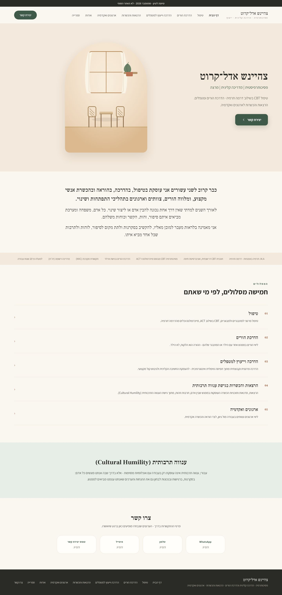

# Playwright pass — 6 Nov 2026

Full-page screenshots of every page at three widths, taken after the changes from
the shared Google Doc (home opening text and credentials, the new About text, the
lectures track's full text, title and testimonial, and the library replacing מאמרים).

Built with `npm run build`, served with `astro preview` under the same
`/tzahaynesh-site/` base as the GitHub Pages review deploy, and driven by
`tests/e2e/run_e2e.py` (Playwright for Python, Chromium, plus axe-core).

**Result: 0 failures.**

## What was checked

Per page, at 375, 768 and 1440 px:

- HTTP 200; `lang="he"`, `dir="rtl"`
- exactly one `h1`, the first heading is the `h1`, no skipped heading levels
- every image has `alt`
- no console errors or page errors
- no horizontal overflow (checked at all three widths, including 375 px)
- `noindex` meta and the draft bar present
- no link or nav item for מאמרים

At 1440 px, axe-core with the WCAG 2.0 A and AA rule sets: **0 violations on all 8 pages**.

Site-wide:

- all 15 internal link targets return 200; `/articles/` is gone (404)
- first Tab stop is the skip link ("דלגו לתוכן הראשי" → `#main`) with a visible outline
- mobile nav: hidden until the toggle is pressed, `aria-expanded` flips to `true`;
  labels read דף הבית · טיפול · הדרכת הורים · הדרכה וייעוץ למטפלים · הרצאות והכשרות ·
  ארגונים ואקדמיה · אודות · ספרייה · יצירת קשר
- library filters: type (תרגילים וכלים → 1 item), topic (הורות → 2), combined
  type + topic with no match shows the empty message, "רק התכנים שלי" → 4
- without JavaScript: the nav is visible, the library shows all 13 items and hides the
  filter bar
- with reduced motion requested: no smooth scrolling

## Screenshots

| Page | Mobile 375 | Tablet 768 | Desktop 1440 |
|---|---|---|---|
| Home | [home](mobile-375/home.jpg) | [home](tablet-768/home.jpg) | [home](desktop-1440/home.jpg) |
| About | [about](mobile-375/about.jpg) | [about](tablet-768/about.jpg) | [about](desktop-1440/about.jpg) |
| Library | [library](mobile-375/library.jpg) | [library](tablet-768/library.jpg) | [library](desktop-1440/library.jpg) |
| טיפול | [therapy](mobile-375/track-therapy.jpg) | [therapy](tablet-768/track-therapy.jpg) | [therapy](desktop-1440/track-therapy.jpg) |
| הדרכת הורים | [parent guidance](mobile-375/track-parent-guidance.jpg) | [parent guidance](tablet-768/track-parent-guidance.jpg) | [parent guidance](desktop-1440/track-parent-guidance.jpg) |
| הדרכה וייעוץ למטפלים | [supervision](mobile-375/track-supervision.jpg) | [supervision](tablet-768/track-supervision.jpg) | [supervision](desktop-1440/track-supervision.jpg) |
| הרצאות והכשרות | [lectures](mobile-375/track-lectures-training.jpg) | [lectures](tablet-768/track-lectures-training.jpg) | [lectures](desktop-1440/track-lectures-training.jpg) |
| ארגונים ואקדמיה | [organizations](mobile-375/track-organizations-academia.jpg) | [organizations](tablet-768/track-organizations-academia.jpg) | [organizations](desktop-1440/track-organizations-academia.jpg) |

Extra states: [mobile nav open](mobile-375/home-nav-open.jpg) ·
[library filtered to תרבות וזהות](desktop-1440/library-filtered-culture.jpg)

## Not covered

- The flyers and the page photo from the doc: the image files couldn't be pulled out
  of the Google Doc, so they aren't on the site yet.
- Library items are still sample data, labelled "נתוני דוגמה" on the page.
- Contrast was checked by axe on the rendered pages; there is still no build-time test
  suite (spec 0001's decision).
